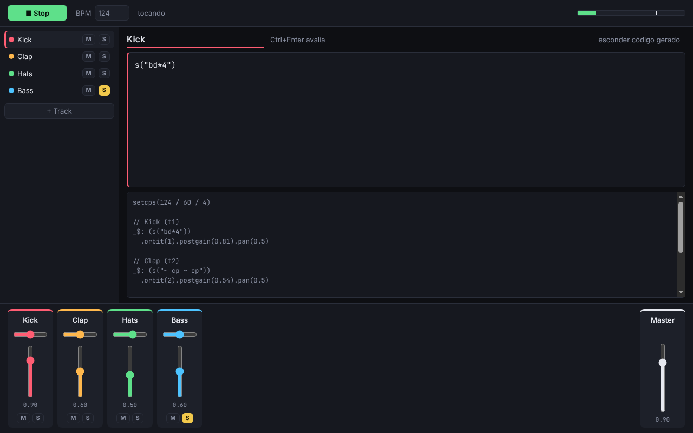

# Afterhours

Estúdio desktop de live coding para música eletrônica: cada track é um bloco de código
[Strudel](https://strudel.cc), com mixer visual por cima. Um "DAW de código", não um concorrente do Ableton.

Spec completo: [`docs/spec.md`](docs/spec.md).



## Estado: Fase 0 (spike)

O caminho crítico do spec está provado: **Strudel tocando dentro do Electron, a partir de código gerado pelo projeto.**

- Projeto → `compile()` → código Strudel com `setcps`, `$:` / `_$:`, `.orbit()` por track.
- Mixer (volume, pan, mute, solo, master) altera só a store; o compilador regenera o código e o engine
  reavalia com debounce de 50 ms, só quando o código gerado muda.
- Track com erro de sintaxe continua tocando a última versão válida, com o erro inline.
- Erro de runtime do Strudel aparece no transporte, e o pattern anterior segue tocando.
- VU do master (RMS + pico) via `AnalyserNode` na saída do superdough.
- Atalhos: `Ctrl+Enter` avalia a track, `Ctrl+.` para tudo, `Espaço` play/stop fora do editor.

O editor ainda é um `<textarea>`; o CodeMirror do Strudel entra no MVP.

## Rodando

Requer Node 22.12+.

```bash
npm install
npm run dev        # app Electron com HMR
npm run dev:web    # só o renderer, no navegador (sem window.studio)
npm test           # testes do compilador (Vitest)
npm run typecheck
npm run build      # gera out/ (main, preload, renderer)
```

Na primeira vez que der play, os samples (`github:tidalcycles/dirt-samples`) são baixados; precisa de internet.

## Arquitetura

A regra central: **o projeto é a fonte da verdade, e o código que o Strudel toca é gerado a partir dele.**

```text
UI (React) ──> store (Zustand) ──> compile(project) ──> engine (Strudel) ──> Web Audio
```

| Pasta | Papel |
| --- | --- |
| `src/shared/` | Tipos do projeto (`Project`, `Track`...) e contrato do preload |
| `src/main/` | Janela Electron (contextIsolation, sandbox, sem nodeIntegration) |
| `src/preload/` | `window.studio`, API mínima. Projeto/samples/export entram no MVP |
| `src/renderer/compiler/` | `compile()`: função pura, sem Strudel nem React. Testada em `compile.test.ts` |
| `src/renderer/engine/` | Única pasta que importa `@strudel/*` (init, evaluate, stop, medidor) |
| `src/renderer/app/engineSync.ts` | Liga store → compilador → engine |
| `src/renderer/features/` | Transporte, lista de tracks, editor, mixer |

As versões de `@strudel/*` estão fixadas no `package.json` (a API interna muda entre versões).

## Decisões tomadas no spike

- **Fader do mixer usa `.postgain()`, não `.gain()`.** No Strudel, `.gain(x)` encadeado depois sobrescreve
  o gain que o usuário escreveu na track (`s("hh*8").gain("[.6 1]*4")` perderia o acento). `postgain` é
  aplicado por cima, como um fader de verdade. Gain efetivo continua sendo `track.gain × master.gain`.
- **Validação da track com `acorn`** (o mesmo parser do transpiler do Strudel): o código precisa ser
  exatamente uma expressão. `;` final e comentários nas pontas são removidos antes de envolver em parênteses.
- **`compile(project, { scene, fallback })`** devolve `{ code, errors, accepted }`. `accepted` vira o
  `fallback` da próxima compilação; é assim que a "última versão válida" (regra 5) fica pura e testável.
- **CSP** permite `'unsafe-eval'` (o Strudel avalia código) e `data:` em `script-src` (os AudioWorklets do
  superdough vêm embutidos como `data:` URL).
- A versão fixada do `@strudel/webaudio` tem `renderPatternAudio()`, candidato para o export offline da fase 2.

## Próximos passos (Fase 1, MVP)

- [ ] Editor com `@strudel/codemirror` (highlight e eventos tocando)
- [ ] Salvar/abrir projeto (JSON) via IPC e autosave em `.autosave.json`
- [ ] Undo/redo com zundo
- [ ] Cache dos samples padrão
- [ ] Remover/reordenar tracks
- [ ] electron-builder (.exe/AppImage)

## Licença

[AGPL-3.0](LICENSE), a mesma do Strudel.
